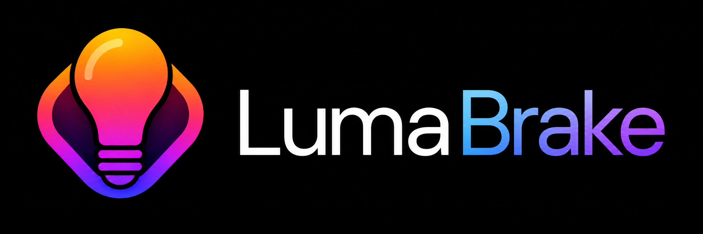
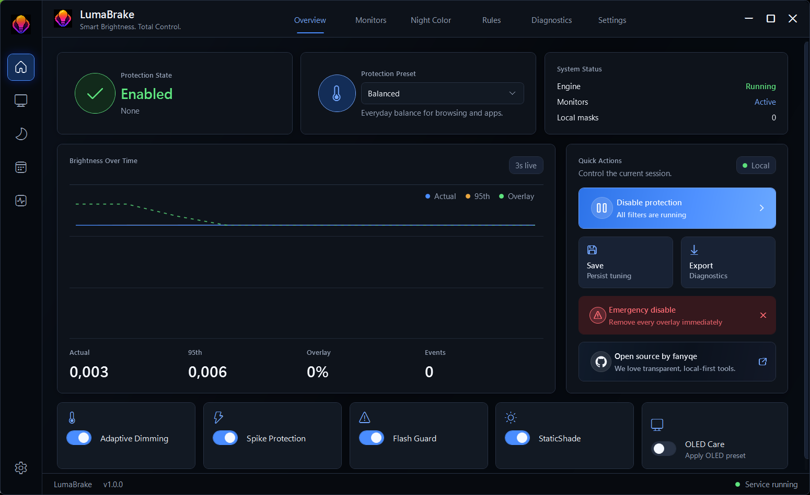
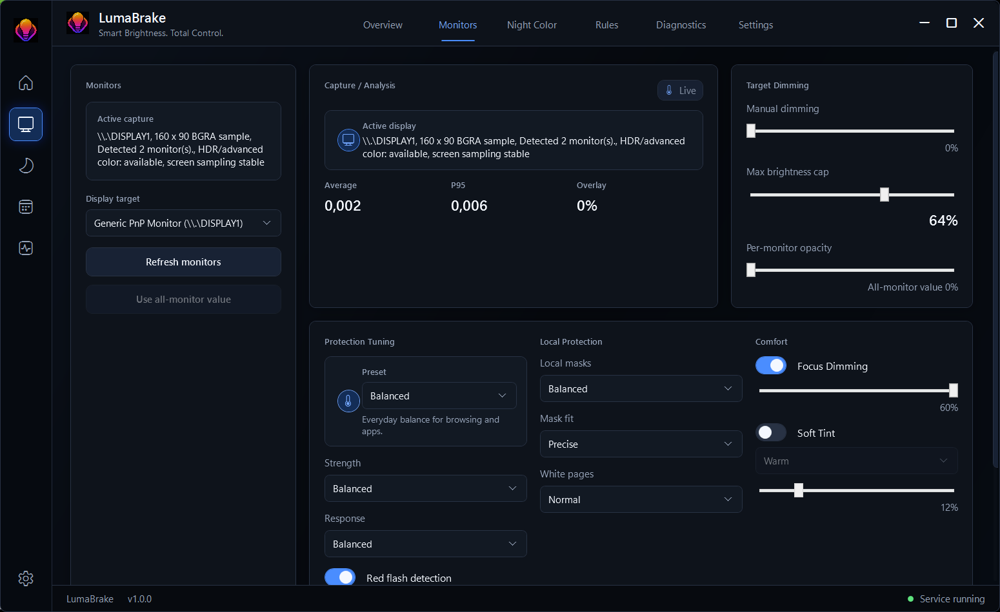
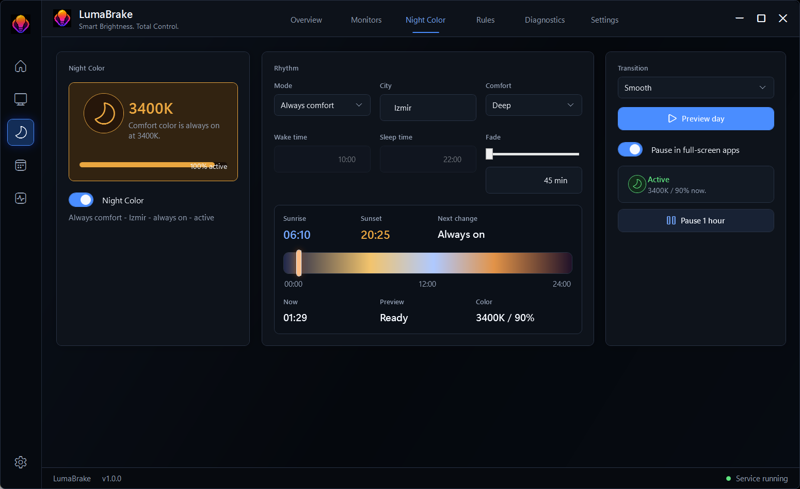
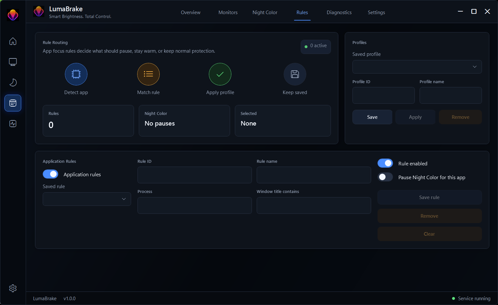
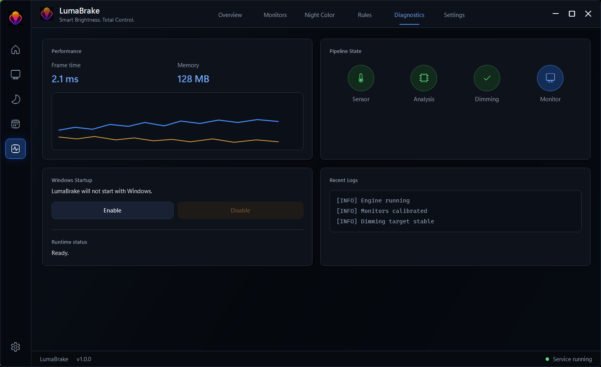
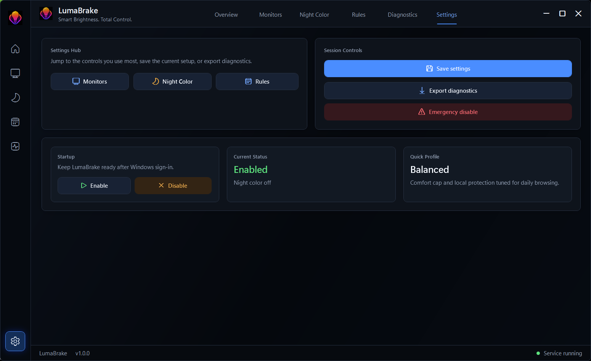

# LumaBrake

<p align="center">
  
</p>

<p align="center">
  <strong>Smart brightness control for Windows.</strong><br>
  Reduce harsh brightness spikes, repetitive flashes, bright static UI regions, and unnecessary light from inactive displays.
</p>

<p align="center">
  <a href="https://github.com/fanyqe/lumabrake/releases/latest"><strong>Download Latest Release</strong></a>
  &nbsp;|&nbsp;
  <a href="#screenshots">Screenshots</a>
  &nbsp;|&nbsp;
  <a href="#features">Features</a>
  &nbsp;|&nbsp;
  <a href="#privacy">Privacy</a>
</p>

LumaBrake is an open-source Windows utility for real-time screen luminance management. It watches the visible brightness profile of your displays, reacts to sudden or repetitive luminance changes, and applies smooth click-through overlays or optional monitor controls so the screen feels calmer without blocking input.

It is built for daily desktop use: browsers, apps, multi-monitor workstations, bright dashboards, dark-to-light transitions, and OLED displays that benefit from less static bright exposure.

## Screenshots

<table>
  <tr>
    <td width="50%">
      
      <br><strong>Overview</strong><br>
      Live protection state, active preset, runtime graph, quick actions, and OLED Care.
    </td>
    <td width="50%">
      
      <br><strong>Monitor Controls</strong><br>
      Per-monitor capture status, target dimming, local protection tuning, focus dimming, and tint controls.
    </td>
  </tr>
  <tr>
    <td width="50%">
      
      <br><strong>Night Color</strong><br>
      City-based rhythm, smooth warm-light preview, pause controls, and full-screen app handling.
    </td>
    <td width="50%">
      
      <br><strong>Profiles and Rules</strong><br>
      Save reusable comfort profiles and apply app-specific behavior without editing config files.
    </td>
  </tr>
  <tr>
    <td width="50%">
      
      <br><strong>Diagnostics</strong><br>
      Runtime health, capture state, latency, recent events, and exportable support data.
    </td>
    <td width="50%">
      
      <br><strong>Settings</strong><br>
      Startup, safety, logging, update behavior, and local data controls.
    </td>
  </tr>
</table>

## What It Does

- Softens abrupt dark-to-bright screen changes before they hit full intensity.
- Detects repetitive bright flashes and can dim the affected area instead of the whole monitor.
- Gradually shades bright static UI regions such as toolbars, HUDs, panels, and white margins.
- Applies adaptive dimming to persistently bright content without constant pulsing.
- Dims inactive monitors and restores them when you interact with them.
- Offers OLED-focused presets for lower static bright exposure.
- Adds optional Night Color scheduling with smooth transitions and city-based sunrise/sunset rhythm.
- Keeps emergency disable close at hand from the dashboard, tray, CLI, and hotkey.

## Features

| Area | What you get |
| --- | --- |
| Brightness Spike Guard | Fast response to sudden bright scenes, dialogs, white pages, and app switches. |
| Flash Guard | Repetitive flash detection with conservative regional masking. |
| StaticShade | Gradual local shading for persistent bright UI surfaces and OLED care profiles. |
| Adaptive Dimming | Smooth content-aware dimming for broad bright pages and documents. |
| Monitor Controls | All-monitor and per-monitor software dimming, local mask tuning, focus dimming, and optional tint. |
| Night Color | Automatic comfort mode by city, manual warm color, preview, pause, and full-screen app behavior. |
| Profiles and Rules | Comfort presets, saved profiles, app rules, schedules, and startup restoration. |
| Diagnostics | Live health view, recent events, monitor/capture status, and redacted diagnostic export. |
| Tray and CLI | Quick tray controls plus `LumaBrake.Cli.exe` for automation and troubleshooting. |

## Install

1. Open the [Latest Release](https://github.com/fanyqe/lumabrake/releases/latest).
2. Download `LumaBrake-win-x64-portable.zip` or the Windows installer when available.
3. Download the matching `.sha256` checksum file.
4. For the portable build, extract the ZIP and run `LumaBrake.App.exe`.
5. Use the dashboard or tray menu to enable protection, choose a preset, and adjust monitor settings.

Verify the portable package checksum in PowerShell:

```powershell
Get-FileHash .\LumaBrake-win-x64-portable.zip -Algorithm SHA256
Get-Content .\LumaBrake-win-x64-portable.zip.sha256
```

The portable package includes:

- `LumaBrake.App.exe` for the dashboard and tray app.
- `LumaBrake.Cli.exe` for status, presets, dimming, Night Color, diagnostics, and startup commands.

## Recommended First Run

1. Launch `LumaBrake.App.exe`.
2. Pick a protection preset: `Comfort`, `Balanced`, `Strong`, `Maximum`, or `OLED Care`.
3. Open `Monitors` and confirm capture is active for each display.
4. Turn on `OLED Care` if you use an OLED monitor.
5. Open `Night Color`, enter your city, and use `Preview day` to see the warm-light rhythm.
6. Keep `Emergency disable` visible until you are comfortable with your settings.

The emergency hotkey is `Ctrl+Alt+Shift+L`.

## System Requirements

- Windows 10 or Windows 11, 64-bit.
- Standard user account for normal portable use.
- SDR display mode recommended for automatic luminance effects.
- DDC/CI-compatible monitors are optional for hardware brightness diagnostics and guarded hardware writes.
- Protected content, exclusive full-screen apps, remote desktop sessions, HDR pipelines, and some GPU drivers can limit capture or overlay behavior.

## Privacy

LumaBrake is designed around local-only screen analysis.

- Raw screen samples are processed in memory and discarded after analysis.
- Screen content is not uploaded, recorded, or stored as screenshots.
- Diagnostics exports contain redacted settings, monitor descriptors, counters, and runtime state, not raw screen frames.
- Settings are stored under the current user's local application data folder.
- Startup registration, when enabled, stores only the local app path and the `--background` argument in the current user's Run key.

Read more in [PRIVACY.md](PRIVACY.md).

## Known Limitations

LumaBrake is a visual comfort utility, not a medical device. It does not guarantee seizure prevention, eye-health outcomes, or OLED burn-in prevention.

- HDR and advanced color displays are handled conservatively.
- Protected video and exclusive full-screen content may block capture or reduce detection accuracy.
- Hardware brightness support depends on the monitor, cable, driver, and DDC/CI behavior.
- Unsigned builds may show Windows SmartScreen or publisher warnings until signing infrastructure is available.
- Local masks are intentionally conservative so normal scrolling and moving content do not feel noisy.

## Build From Source

Install the .NET 10 LTS SDK, then run:

```powershell
dotnet restore
dotnet build LumaBrake.sln
dotnet test LumaBrake.sln --no-build
```

Package the portable build:

```powershell
.\scripts\package-portable.ps1 -Configuration Release -Runtime win-x64
```

## Project Documents

- [BUILDING.md](BUILDING.md) - build and packaging notes.
- [TROUBLESHOOTING.md](TROUBLESHOOTING.md) - common runtime and display issues.
- [SECURITY.md](SECURITY.md) - responsible disclosure.
- [ROADMAP.md](ROADMAP.md) - future improvements.
- [CHANGELOG.md](CHANGELOG.md) - release history.

## Download

Ready to try it?

<p align="center">
  <a href="https://github.com/fanyqe/lumabrake/releases/latest"><strong>Download Latest Release</strong></a>
</p>
